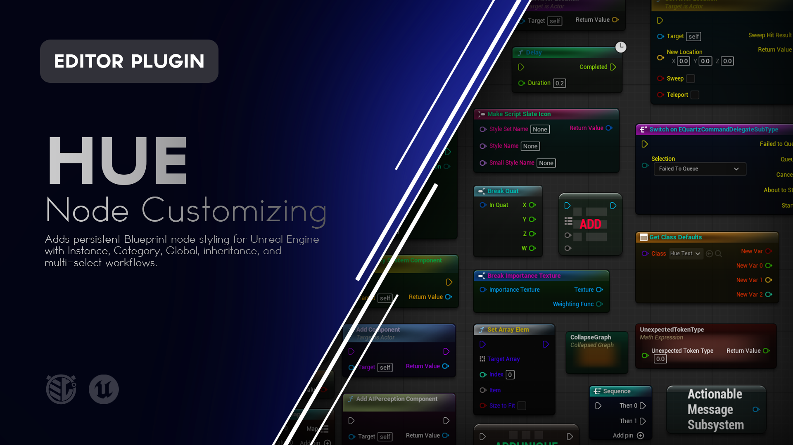

# Hue

**Visual Blueprint Node Styling for Unreal Engine**

**Make your Blueprints easier to read, without changing how they work.**

Hue adds persistent, customizable styling to compatible Blueprint nodes so important operations, shared systems and exceptions are recognizable at a glance. Define visual conventions for individual nodes, Blueprint Categories or matching nodes throughout your project—all from a native Unreal Editor workflow.

    

  

---

## Your Blueprints should communicate more

Blueprint graphs communicate both **what a system does** and **how its pieces relate**. But as graphs grow, events, functions, variables, checks and critical operations can start competing for attention. Comments and good layout help, but not every relationship should need another comment box.

**Hue gives your graphs a consistent visual language.**

- **Find important logic faster.** Give critical operations and frequently used systems a recognizable appearance.
- **Make conventions reusable.** Style one node, related Blueprint members or matching logical nodes project-wide.
- **Keep related nodes visually related.** Let nested Blueprint Categories inherit styling rather than configuring every member separately.
- **Emphasize exceptions without breaking consistency.** Override one channel on one node while inheriting the others.
- **Keep editing familiar.** Work in a dockable Hue panel or compatible node context menus, using native Unreal Undo/Redo.
- **Style the graph, not the gameplay.** Hue changes compatible editor presentations, not Blueprint execution or packaged-game behavior.

For example, a team might use green for queries, blue for movement, orange for combat, purple for UI and red for critical state changes. **These are examples, not preset rules or mandatory categories.**

## Explore the documentation

> ### [**Hue Documentation — Full User Guide and Technical Reference**](https://mippi-the-dork.github.io/Hue/)
>
> **Everything you need to learn and use Hue, in one place.** Follow your first styling workflow, explore each visual channel and styling scope, understand inheritance and precedence, or look up compatible nodes, storage and troubleshooting.
>
> **[Get Started](https://mippi-the-dork.github.io/Hue/?page=01-getting-started%2Ffirst-use%2FDESIGN.md)** · **[Visual Channels](https://mippi-the-dork.github.io/Hue/?page=02-styling-fundamentals%2Fchannels%2FDESIGN.md)** · **[Styling Scopes](https://mippi-the-dork.github.io/Hue/?page=02-styling-fundamentals%2Fscopes%2FDESIGN.md)** · **[Editing Workflows](https://mippi-the-dork.github.io/Hue/?page=04-editing-workflows%2FREADME.md)**

This README is an overview of what Hue offers. **The [documentation website](https://mippi-the-dork.github.io/Hue/) is the maintained reference for exact behavior, installation, supported nodes, workflows and technical details.**

## Four visual channels. Your choice of styling.

Hue provides four independently configurable channels. Change only what you need and keep the other parts of the node's native or inherited appearance.

| Visual channel | What it controls |
| --- | --- |
| **[Header Color](https://mippi-the-dork.github.io/Hue/?page=02-styling-fundamentals%2Fchannels%2FDESIGN.md)** | The primary color of a compatible node's header |
| **Header Text Color** | Text presented in the header |
| **Body Color** | The node's compatible body/background presentation |
| **Body Text Color** | Compatible text presented within the node body |

### One system. Three styling scopes.

| Scope | What it solves | Example |
| --- | --- | --- |
| **[Instance](https://mippi-the-dork.github.io/Hue/?page=02-styling-fundamentals%2Fscopes%2FDESIGN.md)** | Call out a specific occurrence | Highlight one critical `Apply Damage` call |
| **Category** | Keep related user-defined Blueprint members consistent | Give `Combat` functions and variables a shared style |
| **Global** | Recognize the same logical node identity across the project | Identify calls to a particular function wherever they appear |

Hue resolves each channel independently using **Instance → Exact Category → Parent Categories → Global → Unreal Default**. A node can therefore combine an inherited header color, a Global body color and an Instance text override without duplicating whole styles.

[**Learn about style precedence and inheritance →**](https://mippi-the-dork.github.io/Hue/?page=02-styling-fundamentals%2Fprecedence%2FDESIGN.md)

## Useful in real Blueprint workflows

### Give gameplay systems recognizable conventions

Make movement, combat, UI and validation logic easier to spot across busy graphs. Category styling helps keep related Blueprint functions and variables visually consistent, including when Categories are nested.

[**Explore Category styling →**](https://mippi-the-dork.github.io/Hue/?page=03-category-styling%2FREADME.md)

### Recognize shared functionality everywhere

Use Global styling to give a particular logical node identity the same recognizable presentation across the project. Hue matches the node's logical identity—not merely its displayed title—so your rules are more specific than a text-based name match.

### Make an exception stand out

When one operation needs extra attention, apply an Instance override. Change a header, body or text channel without replacing the remaining inherited colors.

### Edit several nodes together

Select compatible nodes and apply styling in one operation. Hue displays mixed values and unsupported selections where appropriate, and integrates with native Unreal **Undo/Redo** transactions.

[**Learn about multi-selection →**](https://mippi-the-dork.github.io/Hue/?page=04-editing-workflows%2Fmulti-selection%2FDESIGN.md)

### Keep styles with your project

Hue stores **Instance and Category styles with Blueprint assets** and **Global styles in project editor configuration**. The distinction matters when saving, reviewing changes and sharing visual conventions through source control.

[**Learn how Hue saves styles →**](https://mippi-the-dork.github.io/Hue/?page=05-technical-reference%2Fstorage%2FDESIGN.md)

## Get Hue

**Hue v1.0.0** targets **Unreal Engine 5.8.0–5.8.3 on Windows 64-bit** and runs in the **Editor only**. It does not require engine source modifications.

Install a compatible release from GitHub, use Fab where available, or build from the source in this repository. Once enabled, open a Blueprint Editor, select a compatible node and open the **Hue** panel.

**[Download GitHub Releases](https://github.com/mippi-the-dork/Hue/releases)** · **[Installation Guide](https://mippi-the-dork.github.io/Hue/?page=01-getting-started%2Finstallation%2FDESIGN.md)** · **[Your First Styled Node](https://mippi-the-dork.github.io/Hue/?page=01-getting-started%2Ffirst-use%2FDESIGN.md)**

## Important limitations

Hue is an **editor-side Blueprint presentation tool**, not a replacement for native node functionality or a runtime gameplay system.

- **Presentation only.** Hue does not change node execution, Blueprint compilation, data flow, gameplay logic or packaged-game rendering.
- **Not every node can be styled.** Coverage depends on whether a compatible K2 node presentation can safely accept a styling channel. Specialized or third-party widgets may retain their native appearance.
- **Some nodes are deliberately excluded.** Reroute and Documentation nodes are unsupported in v1.0.0.
- **Native editable controls remain native.** Hue does not replace embedded numeric fields, checkboxes, dropdowns or pickers just to recolor them.
- **Category has a specific meaning.** It refers to relevant user-defined **My Blueprint Categories**, not arbitrary action-menu groups or C++ node classes.
- **Global doesn't mean every node with the same title.** Global matching uses Hue's logical node identity.
- **Source control is still your responsibility.** Hue does not manage checkouts, permissions or merge conflicts; its Blueprint and project configuration data must be saved and shared normally.
- **No runtime Hue dependency.** The plugin doesn't add a packaged-game styling or gameplay system.

Hue favors preserving native Blueprint behavior over forcing styling onto incompatible controls.

For full details, see [Node Compatibility](https://mippi-the-dork.github.io/Hue/?page=04-editing-workflows%2Fnode-compatibility%2FDESIGN.md) and [Troubleshooting](https://mippi-the-dork.github.io/Hue/?page=06-support%2Ftroubleshooting%2FDESIGN.md).

## What's next?

Hue v1.0.0 establishes the initial styling system: four visual channels, three styling scopes, nested Category inheritance, native editor workflows and persistent style storage.

Future directions are tracked in the documentation. **Roadmap ideas are not promises of inclusion in a specific release.**

[**View the Hue Roadmap →**](https://mippi-the-dork.github.io/Hue/?page=ROADMAP.md)

## Issues, feature requests and contributions

Found a bug? [Open an issue](https://github.com/mippi-the-dork/Hue/issues) with your Hue and Unreal versions, the affected Blueprint node type, scope and channel, reproduction steps, and a screenshot of the **whole affected node**. Include relevant Output Log information where helpful.

Have an idea? [Submit a feature request](https://github.com/mippi-the-dork/Hue/issues) describing the Blueprint readability or authoring problem you want to solve and the result you're after.

**Pull requests are welcome.** For major changes, open an issue first so the intended behavior and scope can be discussed. Contributions should preserve native editing behavior, editor-only operation and predictable persistence, with related documentation updated when applicable.

## License

Hue is distributed under the **MIT License**. See [LICENSE](LICENSE) for the full terms.

---

**Hue is created by Mippi the Dork.**

**[Explore the Documentation](https://mippi-the-dork.github.io/Hue/)** · **[Get Hue](https://github.com/mippi-the-dork/Hue/releases)** · **[Report an Issue](https://github.com/mippi-the-dork/Hue/issues)**
