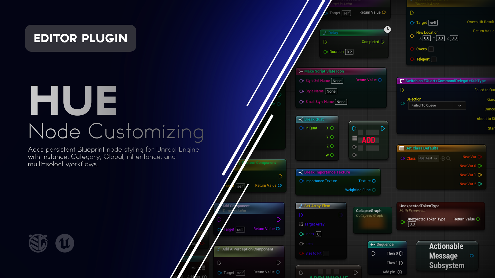

# Hue Documentation

**Hue v1.0.0 · Unreal Engine 5.8.x · Windows 64-bit · Editor-only**

Hue gives compatible Unreal Engine Blueprint nodes persistent, independent color styling for their header, header text, body and body text. You can style one node, a user-defined Blueprint Category or the same logical node identity throughout a project—without changing Blueprint gameplay behavior.

*Hue adds a visual language to Blueprint graphs while leaving their logic and native controls intact.*

## What can I do with Hue?

**Read graphs faster.** Assign visual meaning to systems, stages and types of work rather than relying only on Unreal's default node colors.

**Apply rules at the right scope.** Style one Instance, a My Blueprint Category (including nested parents) or a Global logical identity.

**Mix inherited and local styles.** Each of the four visual channels chooses its effective override independently, making precise exceptions possible.

**Edit efficiently.** Use a dockable Hue panel, node context menus and multi-selection; clear a channel to reveal the next inherited value.

## Get started in three steps

1. [Install and enable Hue](01-getting-started/installation/DESIGN.md) in a supported Unreal Editor project.
2. [Open the Hue panel](01-getting-started/first-use/DESIGN.md) in a Blueprint editor and select a compatible node.
3. [Apply an Instance style](02-styling-and-inheritance/styling-scopes/DESIGN.md), then try Category and Global styling.

## How the style resolves

**Instance → Exact Category → Nearest parent Category → Higher parents → Global → Unreal default.** This order is evaluated independently for Header Color, Header Text Color, Body Color and Body Text Color. Clearing a local override reveals the next available source; it does not necessarily reset the entire node to Unreal's default.

## Which documentation should I read?

**Design** explains what to click, what changes, when to use each option, and how to troubleshoot. **Technical** identifies the Blueprint and project data owners, native Slate adapters, relevant classes and unsupported paths. Each of the 19 feature topics has both.

## Explore the manual

| Category | Topics | What you'll find |
| --- | ---: | --- |
| [01. Getting Started](01-getting-started/README.md) | 3 | What Hue is, how to install it, and the first Blueprint styling workflow |
| [02. Styling and Inheritance](02-styling-and-inheritance/README.md) | 4 | Four color channels, three style scopes, precedence, and removing overrides |
| [03. Categories and Node Identity](03-categories-and-identity/README.md) | 4 | Nested category inheritance, migration, global identities and compatibility |
| [04. Editing Workflows](04-editing-workflows/README.md) | 4 | The panel, context menus, multi-selection and saving/Undo |
| [05. Technical and Support](05-technical-and-support/README.md) | 4 | Architecture, persistence details, troubleshooting and updating |

## Important limits

Hue v1.0.0 does not modify Blueprint logic, compilation or packaged-game rendering. Its editing options appear only for node presentations it can safely style. Reroute and Documentation nodes are intentionally unsupported, and native numeric inputs, dropdowns, checkboxes and pickers remain Unreal-owned.

## Project and support

- [Hue source repository](https://github.com/mippi-the-dork/Hue)
- [Hue releases](https://github.com/mippi-the-dork/Hue/releases)
- [Report a problem or suggest an improvement](https://github.com/mippi-the-dork/Hue/issues)
- [Roadmap](ROADMAP.md) — released baseline and future directions
- [Media inventory](MEDIA_INVENTORY.md) — required documentation images and GIFs

**Verification basis:** Hue v1.0.0 README and inspected Unreal C++ source. Feature guidance is source-grounded; exhaustive live-editor and browser QA are separately tracked.
